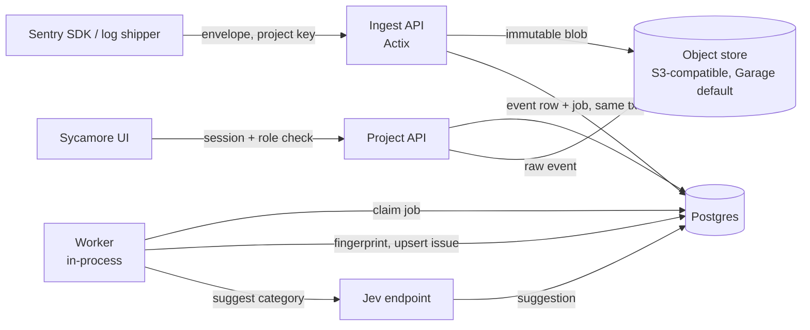

# Scout architecture

One Actix binary serves the ingest API and the Sycamore UI, writes payloads to S3-compatible storage
and metadata to Postgres, and runs its own background workers against a Postgres job queue. Nothing
on the ingest path waits for a classifier.

## Drivers

- Ingest must survive a slow or unreachable decision model ([scout-goal](goal-and-requirements.md)).
- The raw payload is the source of truth; grouping and suggestions are derived and re-derivable.
- Self-hosting stays cheap to operate: three services, no broker, no search cluster.

## Flow

## Components

**Ingest API** — `POST /api/{project}/envelope/` and the legacy `/store/` endpoint. Authenticates the
project key, extracts the event from the envelope, writes the untouched envelope to object storage,
then inserts an event row and a grouping job in one Postgres transaction and replies with the event id.
It does not group, and it never calls the decision model. A rejection (bad key, malformed envelope) is
the only failure that loses input, and it is reported to the SDK.

**Object store adapter** — the only writer of raw payloads. Keys are
`raw/{project_id}/{event_id}` for an event's bytes and
`attachments/{project_id}/{event_id}/{index}` for its attachments; writes are append-only, and no
component rewrites or deletes a stored payload except per-project retention. Raw payloads live here in
full; Postgres holds only what the UI queries. The adapter addresses any S3-compatible store through
endpoint, bucket, region, and credentials; Garage is the shipped default, and MinIO or another
provider is configuration rather than code. A dedicated `scout migrate-objects` mode of the same
binary copies objects between two stores without starting the server, ingest, workers, or retention.

**Grouping worker** — claims queued jobs, computes the fingerprint, upserts the issue, links the event,
and moves issue counters. Deterministic: the same stored events always produce the same grouping.

**Categorisation service** — per project, the owner supplies a **Jev-compatible endpoint** URL, an
optional bearer key, and the model id (default `jev-latest`). Once the payload is stored, the worker
sends one System One call — `POST {endpoint}/v1/systemone` — with `state` set to a compact summary of
the item and a single `questions.category` of `type: choice` over `issue` / `log` / `raw_event`. The
returned `choice` and `confidence` are stored on the item as a **suggestion** for a triager to accept
or override. The call has a bounded timeout and at most one retry; any failure leaves the item with no
suggestion, which is a normal state, not an error state. It never changes what was stored, never hides
an item, and never blocks ingest.

The request Scout sends is fixed in shape: `{ model, state: 
, questions: { category: { type:
"choice", instructions, criteria } } }`. Only that summary crosses the boundary; the stored payload is
never shipped whole. The summary carries the message, the exception type, the endpoint that received
it, and a sample of the payload capped at 2 KB.

**Web API and UI** — the Sycamore app is served by the same Actix binary; the API it calls enforces
authorisation per request. Issue list and detail (with the raw event fetched from object storage),
project settings and keys, members and roles, invites, model configuration, SSO configuration.

**Identity and authorisation** — local accounts first; OIDC is a provider behind one interface so a
deployment can add SSO without a second user system. Two principal kinds: interactive users (session,
resolved to org/project memberships and roles) and project keys (ingest only, scoped to exactly one
project).

**Worker runtime** — one in-process worker pool in the same binary, claiming jobs from Postgres with
`FOR UPDATE SKIP LOCKED`. No broker to deploy, and one process to scale; the queue is in Postgres, so a
separate worker process can be added later without changing ingest.

## Data ownership

| Store | Owns | Never holds |
| --- | --- | --- |
| Postgres | orgs, projects, keys, users, memberships, roles, issues, event metadata, suggestions, log rows, jobs | raw payloads |
| Object storage | the exact bytes received per event | anything queried by the UI without an event id |

## Grouping

Fingerprint = hash over the exception type chain plus the top in-app stack frames of the event, with
the project id mixed in. Events without a stack trace fall back to a normalised message hash. The
fingerprint is stored on the event and on the issue, so a grouping-rule change is a re-derivable
migration over stored events rather than a data loss.

## Access control

Every stored row carries `project_id`; every query is filtered by it, and authorisation is checked
server-side before data is touched — never in the UI. Roles are scoped to a project (owner, admin,
triager, viewer); organisation membership only decides which projects a person can be granted.
Ingest keys are per project and cannot read.

## Deployment

`scout` (API + UI + worker) · `postgres` · `garage`, from a single compose file. Garage is the default
S3-compatible object store. The shipped compose starts it with `--single-node --default-bucket` and the
`GARAGE_DEFAULT_*` values, so the single-node layout, bucket, and access key are created automatically;
manual CLI provisioning remains the fallback for Garage versions before 2.3.0 or custom layouts. Any
other S3-compatible provider (MinIO included) works by setting the usual endpoint, bucket, region, and
credentials. Migrations run on startup against an advisory lock, so several replicas can start at once.

## Sentry compatibility

Ingest speaks Sentry's envelope protocol. With `SCOUT_SENTRY_API_COMPAT_ENABLED=true`, a bounded
read-API surface is also served under `/api/0/`: project issues (list, filter, sort, cursor
pagination, status mutation), project and issue tag values, and honest empty or `501` answers for
Sentry subsystems Scout does not implement (releases' commit files, service hooks, legacy user
reports, spike protection, Sentry apps, external issues). The surface is off by default, uses
long-lived hashed bearer tokens whose scopes come from the owner's live roles, and never invents
data. Metrics and tracing stay out of scope.

## Out of scope

Metrics and tracing ingest, SCIM, Teams, and any hosted/managed mode — all excluded by
[scout-goal](goal-and-requirements.md). Sentry read-API compatibility is limited to the documented
`/api/0/` surface above.
