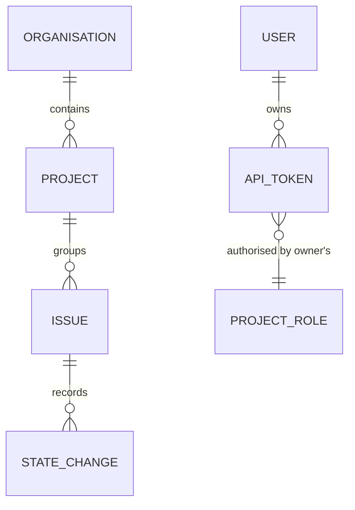

# Data Model: Sentry Read-API Compatibility

Two persisted additions (`ApiToken`, `Organisation.slug`), one derived attribute change
(`Issue.number`), and several derived, non-persisted shapes. No raw payload or event data changes.

## Persisted entities

### ApiToken (new)

| Field | Type | Rules |
|---|---|---|
| `id` | UUID | Primary key; exposed only as a management identifier, never as an auth credential. |
| `user_id` | UUID | Owner. Must reference an existing user; tokens do not outlive `User.disabled_at` enforcement. |
| `label` | string | 1–100 characters after trim; required so a person can tell tokens apart. |
| `token_hash` | string (hex) | SHA-256 of the full plaintext (`scout_pat_…`). Unique. Skipped from all serialisation. |
| `token_prefix` | string | First 14 characters of the plaintext, for identification. |
| `created_at` | timestamp | Set at creation. |
| `last_used_at` | timestamp, nullable | Best-effort; written when older than 1 hour. |
| `revoked_at` | timestamp, nullable | Set once; revocation is terminal. |

**Invariants**

- The plaintext is returned exactly once, at creation, and is never persisted or logged.
- There is no scope column and no expiry column: permissions are derived per request from
  `user_id`'s live `Role`/`OrgRole`, and expiry is not a concept (clarifications 1 and 2).
- A revoked token is rejected even if the hash still matches.
- Deleting a user (or disabling them) makes their tokens unusable without touching the rows.

**Lifecycle**

```text
created ──revoke──> revoked
   │                   │
   └──(user disabled)──┴──> unusable
```

### Organisation (modified)

| Field | Type | Rules |
|---|---|---|
| `slug` | string | Derived from the name at creation: lowercase, `[a-z0-9-]`, collapsed runs, trimmed, ≤48 chars; on collision append `-2`, `-3`, … Unique case-insensitively. Stable thereafter even if the name changes. |

**Backfill**: existing organisations receive a slug derived from their current name in creation
order, so slugs are deterministic across restarts. Empty or all-symbol names fall back to `org`,
`org-2`, …

### Issue (modified)

| Field | Type | Rules |
|---|---|---|
| `number` | u64 | Per-project monotonic sequence assigned when the issue row is first created. Immutable afterwards. Unique within a project. Used for `shortId` and as the cursor tiebreak sibling to the sort key. |

Existing issues are backfilled in `first_seen` order per project; new issues receive
`max(number) + 1` for their project at creation (both grouping and demo seeding paths).

## Derived entities (not persisted)

### SentryIssueProjection

| Field | Source |
|---|---|
| `id` | `Issue.id` as a string |
| `shortId` | `{Project.slug uppercased}-{Issue.number}` |
| `title`, `culprit`, `level` | `Issue.title`, `Issue.culprit`, `Issue.level` |
| `status` | `Issue.state` → `unresolved` (Open) / `resolved` / `ignored` |
| `statusDetails` | `{}` always present; `{"ignoreCount": <n>}` when ignored (n = 0 in this slice) |
| `count` | `Issue.count` (number) |
| `userCount` | `0` — Scout does not track distinct users |
| `firstSeen`, `lastSeen` | `Issue.first_seen`, `Issue.last_seen` (RFC 3339 UTC) |
| `metadata` | `{"title": Issue.title, "value": Issue.culprit or ""}` |
| `permalink` | `{self_url}/#/issues/{Issue.id}` |
| `project` | `{id, name, slug, platform: null}` |
| `tags` | `Issue.tags` object → `[{key, value}]`, empty values omitted |
| `annotations` | `[]` |

**Status mapping is bidirectional** (FR-012): `unresolved ↔ open`, `resolved ↔ resolved`,
`ignored ↔ ignored`. The reverse direction is used by the mutation handler.

### TagValue

- Derived from `Issue.tags[key]` across the addressed scope (project or single issue).
- Non-string scalars are stringified (`true`, `42`); objects/arrays/null and empty strings are
  skipped.
- De-duplicated, sorted ascending by `name`, `query` filters case-insensitively by contains, capped
  at 1,000. Never `404` for a missing key: an empty list.

### PaginationCursor

| Field | Meaning |
|---|---|
| `v` | Cursor format version (`1`) |
| `q` | 16-hex SHA-256 fingerprint of the normalised query tuple (query text, sort, repeated ids, hashes, org, project) |
| `s` | Sort mode the cursor was issued for |
| `k` | Last sort key value (`last_seen`/`first_seen` timestamp or `count` number) |
| `i` | Last issue UUID, the deterministic tiebreak |

Encoded as base64url without padding. Not persisted; carries no secret and authorises nothing.
Mismatched `q` → `400`; undecodable → `400`; past the end → empty page, `results="false"`.

### Scope

Derived per request from the owner's live roles; never stored.

| Role | Scopes |
|---|---|
| Viewer | `event:read`, `project:read` |
| Triager | Viewer + `event:write` |
| Admin / Owner | Triager + `project:write`, `project:admin`, `event:admin`, `project:releases` |
| Organisation member | `org:read` |
| Organisation admin | `org:read`, `org:admin`, `org:integrations` |

### CompatibilityException

| Subsystem | Read behaviour | Mutation behaviour |
|---|---|---|
| Release commit files | `[]` for a known release; `404` otherwise | n/a (read-only path) |
| Project service hooks / detail | `[]` / `404` for a specific hook | `501` |
| Project user feedback | `[]` | `501` |
| Spike protection | `404` (no state exists) | `501` |
| App installations | `[]` | `501` |
| External issues | — | `501` |
| Issue deletion | — | `501` (history and raw payloads are preserved) |

## Migration (PostgreSQL parity)

`migrations/0007_sentry_compat.sql`, idempotent:

```sql
ALTER TABLE organisations ADD COLUMN IF NOT EXISTS slug TEXT;
UPDATE organisations SET slug = lower(regexp_replace(name, '[^a-zA-Z0-9]+', '-', 'g'))
 WHERE slug IS NULL;
CREATE UNIQUE INDEX IF NOT EXISTS organisations_slug_key ON organisations (lower(slug));

ALTER TABLE issues ADD COLUMN IF NOT EXISTS number BIGINT NOT NULL DEFAULT 0;
CREATE UNIQUE INDEX IF NOT EXISTS issues_project_number_key ON issues (project_id, number);
-- Backfill numbers per project in first_seen order, skipping already-numbered rows.

CREATE TABLE IF NOT EXISTS api_tokens (
    id           UUID PRIMARY KEY,
    user_id      UUID NOT NULL REFERENCES users (id) ON DELETE CASCADE,
    label        TEXT NOT NULL,
    token_hash   TEXT NOT NULL UNIQUE,
    token_prefix TEXT NOT NULL,
    created_at   TIMESTAMPTZ NOT NULL,
    last_used_at TIMESTAMPTZ,
    revoked_at   TIMESTAMPTZ
);
CREATE INDEX IF NOT EXISTS api_tokens_user_id_idx ON api_tokens (user_id);
```

Slug collision resolution is performed in application code for both representations; the SQL
backfill is the deterministic starting point for existing rows.

## Relationships



No new relationship is introduced between tokens and projects or organisations: authorisation is
always resolved through the owner's existing role rows, which keeps revocation and role changes
immediate.
