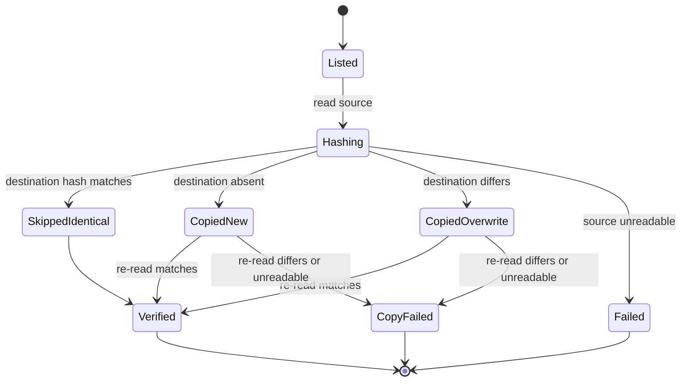
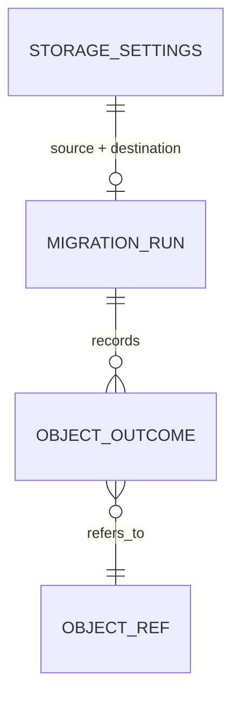

# Data Model: Garage Object Storage

This feature changes no database schema and no stored object format. The entities below are
operational: configuration, the objects being moved, and the migration run's outcome.

## Storage Settings

### Destination (runtime)

| Setting | Source | Rules |
|---|---|---|
| Endpoint | `SCOUT_S3_ENDPOINT` | Required together with the bucket. Must include `http://` or `https://`; `http://` enables plain-HTTP access. |
| Bucket | `SCOUT_S3_BUCKET` | Required. Must exist and be writable before the server accepts telemetry. |
| Access key | `AWS_ACCESS_KEY_ID` | Required for S3; provider-issued. |
| Secret key | `AWS_SECRET_ACCESS_KEY` | Required for S3; never logged. |
| Region | `AWS_REGION` | Required for S3; must match the provider (`garage` in the shipped compose). |
| Addressing | derived | Path-style requests are used so a plain host:port endpoint works without wildcard DNS. |
| Timeouts | derived | Connect (5 s) and request (10 s) timeouts plus at most 2 retries are part of the settings, so an unreachable endpoint fails within 60 seconds. |

When endpoint and bucket are absent, the runtime keeps today's in-memory backend for local
development and tests.

### Source (migration only)

| Setting | Source | Rules |
|---|---|---|
| Endpoint | `SCOUT_MIGRATE_SOURCE_ENDPOINT` | Required; same scheme rules as the destination. |
| Bucket | `SCOUT_MIGRATE_SOURCE_BUCKET` | Required. |
| Access key | `SCOUT_MIGRATE_SOURCE_ACCESS_KEY_ID` | Required. |
| Secret key | `SCOUT_MIGRATE_SOURCE_SECRET_ACCESS_KEY` | Required; never logged. |
| Region | `SCOUT_MIGRATE_SOURCE_REGION` | Required. |

**Validation**: a missing variable aborts before any listing with a message naming the variable. The
migration never modifies source objects.

## Object Ref

| Field | Meaning |
|---|---|
| `key` | The stored key, `raw/{project}/{event}` or `attachments/{project}/{event}/{index}`. Copied verbatim. |
| `size` | Bytes, from the source listing; used to short-circuit impossible matches. |
| `sha256` | Content hash of the source bytes, computed once per object. |

Keys are opaque to the migration: no renaming, re-prefixing, or re-encoding occurs.

Only `raw/` and `attachments/` objects are migrated. Keys under the `__scout/` prefix are startup-probe
sentinels: they are ignored and never counted in `found`.

## Migration Outcome (per object)

| Outcome | Meaning | Counted as |
|---|---|---|
| `SkippedIdentical` | Destination already holds bytes with the same SHA-256. | skipped, verified |
| `CopiedNew` | Destination had no object under the key; bytes written **and re-read successfully**. | copied, verified |
| `CopiedOverwrite` | Destination held different bytes; source bytes written over them **and re-read successfully**. | copied, verified |
| `CopyFailed` | The write succeeded but the re-read differed or was unreadable, or the destination bytes differ from the source during comparison or after a copy; the object is not usable at the destination. | failed (never copied); plus `mismatched` when the bytes differ |
| `Unreadable` | Source or destination could not be read (permissions, network, missing after list). | failed |

A differing copy increments both `failed` and `mismatched`; an unreadable one increments only `failed`.
`mismatched` is therefore a subset of `failed`, never a separate outcome.

A destination object that differs and is successfully overwritten and re-verified is `CopiedOverwrite`
and counts as verified; it does not fail the run.

**Invariants**

- `found = skipped + copied + failed`, where `copied` counts **only verified** copies
- `verified = skipped + copied`
- `mismatched ⊆ failed` (a mismatch is one kind of failure)
- `found = verified` and `failed = 0` ⇔ exit status `0`
- Source objects are never written or deleted on any path.

## Migration Run

| Field | Meaning |
|---|---|
| source / destination settings | As above, resolved once at start. |
| `found`, `copied`, `skipped`, `verified`, `mismatched`, `failed` | Counters for the final summary; `found` excludes `__scout/` sentinels and `mismatched` is a subset of `failed`. |
| `failures` | Keys that failed, logged as they occur and summarised at the end (bounded list in output; every key is logged). |
| `elapsed_ms` | Elapsed milliseconds for the summary log line. |
| exit status | `0` when every object is verified; `1` when any object fails or configuration is invalid. |

The run is not persisted; re-running is the recovery mechanism.

## Startup Probe

The server performs a write/delete of a unique sentinel key (`__scout/health/<uuid>`) in the
destination bucket before serving. It is implemented as `Objects::verify_writable()` in
`src/objects.rs`; `main` calls it before wiring the server. The probe runs before the server binds, and
any failure must abort startup within 60 seconds. Outcomes:

| Outcome | Effect |
|---|---|
| Sentinel written and deleted | Storage is writable; server starts. |
| Missing bucket / invalid credentials / unreachable host | Startup fails with endpoint and bucket named, and the likely cause. |
| In-memory backend | Probe skipped. |

## State Transitions

## Relationships

No relationship is added to the metadata database: object keys already present in issue and event
rows keep pointing at the same keys after cutover.
